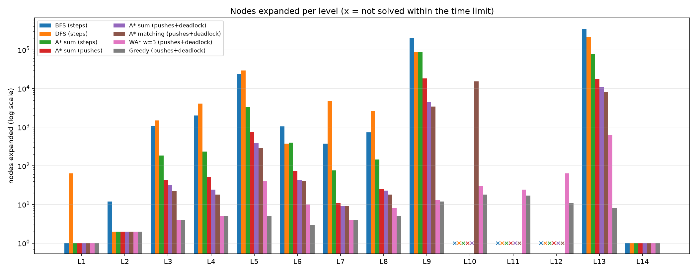
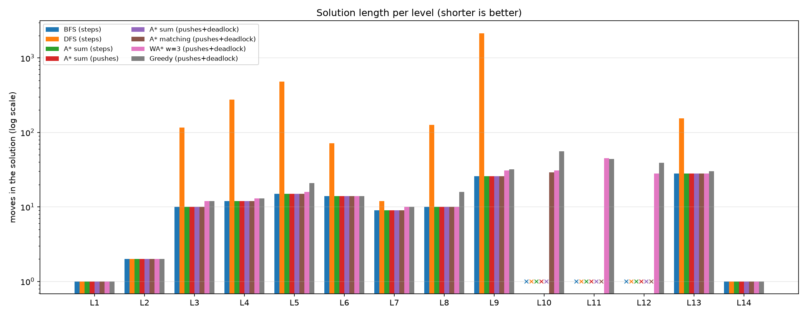
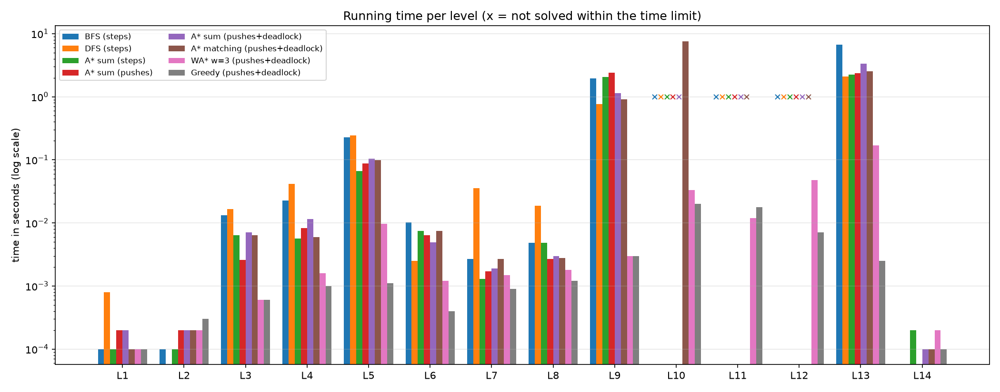
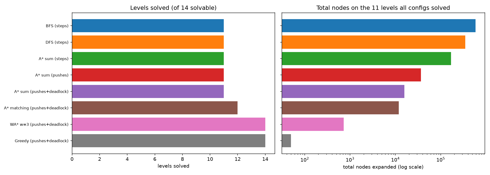

# Sokoban Solver

An AI course project. The player pushes boxes around a grid onto goal squares. Boxes can only be **pushed, never pulled**, so a box can get stuck against a wall or in a corner. Our program solves the puzzle automatically with **BFS, DFS, A\*, weighted A\* and greedy search** (using a distance heuristic and deadlock detection) and compares how efficient each approach is on 16 levels.

## What it does

- Reads a level from a text file in `levels/`.
- Applies the Sokoban rules (walls block, a box moves only if the square behind it is free, solved when every box is on a goal).
- Solves a level with BFS, DFS, A\*, weighted A\* or greedy search, with optional deadlock pruning and push-based moves.
- Shows the solution step by step in a Streamlit app, with all options on the main screen.
- Benchmarks every configuration on every level, saves the numbers to `experiments/results_all.csv` and draws the report charts.
- Lets you play a level yourself in a second app (`app_play.py`), with undo and an A\* hint button.

## Team

| Member | Name | Responsibility |
|---|---|---|
| 1 | Panuganti Vishishta | Game rules and setup: `level_parser.py`, `state.py`, `moves.py`, `render.py`, `main.py`, `test_engine.py` |
| 2 | Kollati Devi Chandrika | BFS and DFS: `bfs_dfs.py`, `run_bfs_dfs.py`, `test_bfs_dfs.py` |
| 3 | Nandyala Vaishnavi | A\* search and heuristics: `astar.py`, `heuristics.py` |
| 4 | Namburi Veda Aishwarya | Deadlock detection and the demo app: `deadlock.py`, `app.py`, `viz.py` |
| 5 | Chaitrali Zode | Levels, experiments, results table and charts, report, slides |

## Project structure

```
Sokoban-Solver/
├── README.md
├── requirements.txt
├── app.py                    # Streamlit solver app (pick level and solver, run, replay)
├── app_play.py               # Streamlit app: play yourself + solver demo
├── levels/                   # Level-1.txt ... Level-16.txt
├── src/
│   ├── level_parser.py       # reads a level file
│   ├── state.py              # State(player, boxes), hashable
│   ├── moves.py              # rules, successors, push-based successors
│   ├── render.py             # text drawing of a state
│   ├── main.py               # small CLI: show a level, replay moves
│   ├── bfs_dfs.py            # BFS and DFS (Member 2)
│   ├── astar.py              # A*, weighted A* and greedy search
│   ├── heuristics.py         # sum of distances, box-goal matching
│   ├── deadlock.py           # dead squares and 2x2 freeze checks
│   ├── baselines.py          # BFS/DFS with the shared result type
│   ├── result.py             # SearchResult used by every solver
│   ├── play.py               # game logic for playing by hand (undo, hint)
│   ├── runner.py             # the 8 algorithm configurations
│   └── viz.py                # board drawing for the app
├── experiments/
│   ├── run_bfs_dfs.py        # earlier BFS/DFS experiment
│   ├── run_all.py            # all configurations on all levels
│   ├── make_charts.py        # charts and summary from results_all.csv
│   ├── results_bfs_dfs.csv
│   ├── results_all.csv       # results shown below
│   └── results_long.csv      # exact A* on Levels 10-12 with an 80 s limit
├── results/
│   ├── results_summary.csv
│   └── charts/               # nodes_expanded.png, solution_length.png, time.png, summary.png
├── tests/
│   ├── test_engine.py
│   ├── test_bfs_dfs.py
│   ├── test_astar.py
│   └── test_play.py
└── report/
    └── REPORT_TEMPLATE.md
```

## Installation

You need Python 3.8 or newer (Streamlit 1.36 or newer for the app).

```bash
git clone <your-repo-url>
cd Sokoban-Solver
python -m venv .venv
# Windows:   .venv\Scripts\activate
# Mac/Linux: source .venv/bin/activate
pip install -r requirements.txt
```

## Usage

Run everything from the project root.

```bash
python -m pytest -q                                   # run the tests
streamlit run app.py                                  # open the app
python -m experiments.run_all --time-limit 10         # rerun all experiments
python -m experiments.make_charts                     # redraw the charts from the CSV
streamlit run app_play.py                             # play a level yourself
python -m src.main --level levels/Level-2.txt         # show a level in the terminal
python -m src.main --level levels/Level-2.txt --replay RR   # replay moves (lowercase = step, UPPERCASE = push)
```

In the app, choose a level with **Previous level / Next level** (or the dropdown), pick the algorithm and options, press **Run solver**, then use **Back / Forward / Play solution** to watch the answer.

In code:

```python
from src.level_parser import load_level
from src.astar import astar

res = astar(load_level("levels/Level-9.txt"), "matching")
print(res.status, res.moves, res.nodes_expanded, res.solution)
```

## Level file format

| Symbol | Meaning |
|---|---|
| `#` | wall |
| `@` | player |
| `+` | player on a goal |
| `$` | box |
| `*` | box on a goal |
| `.` | goal |
| space | floor |

Each level has one player, and as many boxes as goals.

## How it works

**State.** The player position plus the set of box positions. Walls and goals never change, so they are stored once per level.

**Algorithms.**

| Solver | Idea | Strength | Weakness |
|---|---|---|---|
| BFS | Explore all states level by level | Shortest solution | Memory and time grow fast |
| DFS | Follow one path as deep as possible | Little memory | Very long solutions |
| A\* | Expand the state with the lowest `f = g + h` | Shortest solution, far fewer states | Needs a good heuristic |
| Weighted A\* | Lowest `f = g + 3 * h` | Much faster, usually near-shortest | Solution can be longer than the shortest |
| Greedy best-first | Lowest `h` only | Fastest, solves the hardest levels | Solutions can be much longer, no guarantee |

**Heuristics (both never overestimate, so A\* finds a shortest solution).**
- `sum`: each box's Manhattan distance to its nearest goal, added up.
- `matching`: the cheapest one-to-one assignment of boxes to goals, which is tighter because two boxes cannot use the same goal.

**Deadlock detection.** A state is dropped if it can never be solved: a box on a "dead square" (for example a corner that is not a goal, or a wall line with no goal along it) or a 2x2 block of boxes and walls.

**Configurations compared.**

| Name | Meaning |
|---|---|
| BFS, DFS | one search step = one player step |
| A\* sum (steps) | A\* with the `sum` heuristic, one step per player step |
| A\* sum (pushes) | one search step = one box push (walking counted in the cost) |
| A\* sum (pushes + deadlock) | the above plus deadlock pruning |
| A\* matching (pushes + deadlock) | the same with the `matching` heuristic |
| WA\* w=3 (pushes + deadlock) | weighted A\* with weight 3 and the `matching` heuristic |
| Greedy (pushes + deadlock) | greedy best-first with the `matching` heuristic |

## Results

All runs: 16 levels, 8 configurations, 10 second limit per run, one run each. Raw data is in `experiments/results_all.csv`. The results table `results/results_summary.csv` and the charts in `results/charts/` are made from it with `python -m experiments.make_charts`.

The numbers in `results_all.csv` come from `src/baselines.py` and `src/astar.py`, so every algorithm uses the same time limit and node counting. `src/bfs_dfs.py` is the standalone BFS/DFS of Member 2, and its own experiment (`run_bfs_dfs.py`) writes `results_bfs_dfs.csv`.

### Nodes expanded (fewer is better)

| Level | BFS | DFS | A* sum (steps) | A* sum (pushes) | A* sum (pushes + deadlock) | A* matching (pushes + deadlock) | WA* w=3 (pushes + deadlock) | Greedy (pushes + deadlock) |
|---|---:|---:|---:|---:|---:|---:|---:|---:|
| Level-1 | 1 | 64 | 1 | 1 | 1 | 1 | 1 | 1 |
| Level-2 | 12 | 2 | 2 | 2 | 2 | 2 | 2 | 2 |
| Level-3 | 1,078 | 1,501 | 183 | 43 | 32 | 22 | 4 | 4 |
| Level-4 | 1,983 | 4,076 | 233 | 51 | 24 | 18 | 5 | 5 |
| Level-5 | 23,639 | 29,451 | 3,348 | 760 | 382 | 284 | 40 | 5 |
| Level-6 | 1,051 | 378 | 400 | 73 | 43 | 41 | 10 | 3 |
| Level-7 | 378 | 4,660 | 76 | 11 | 9 | 9 | 4 | 4 |
| Level-8 | 726 | 2,607 | 145 | 25 | 23 | 18 | 8 | 5 |
| Level-9 | 207,129 | 88,456 | 87,634 | 18,363 | 4,466 | 3,436 | 13 | 12 |
| Level-10 | timeout | timeout | timeout | timeout | timeout | 15,346 | 30 | 18 |
| Level-11 | timeout | timeout | timeout | timeout | timeout | timeout | 24 | 17 |
| Level-12 | timeout | timeout | timeout | timeout | timeout | timeout | 64 | 11 |
| Level-13 | 350,591 | 215,853 | 76,618 | 17,377 | 10,877 | 8,119 | 634 | 8 |
| Level-14 | 1 | 1 | 1 | 1 | 1 | 1 | 1 | 1 |
| Level-15 | unsolvable (5) | unsolvable (5) | unsolvable (5) | unsolvable (1) | unsolvable (0) | unsolvable (0) | unsolvable (0) | unsolvable (0) |
| Level-16 | unsolvable (70) | unsolvable (70) | unsolvable (70) | unsolvable (7) | unsolvable (0) | unsolvable (0) | unsolvable (0) | unsolvable (0) |

### Solution length (moves)

| Level | Shortest | DFS | WA* w=3 | Greedy | Pushes (shortest) |
|---|---:|---:|---:|---:|---:|
| Level-1 | 1 | 1 | 1 | 1 | 1 |
| Level-2 | 2 | 2 | 2 | 2 | 2 |
| Level-3 | 10 | 117 | 12 | 12 | 6 |
| Level-4 | 12 | 275 | 13 | 13 | 5 |
| Level-5 | 15 | 480 | 16 | 21 | 5 |
| Level-6 | 14 | 72 | 14 | 14 | 5 |
| Level-7 | 9 | 12 | 10 | 10 | 4 |
| Level-8 | 10 | 126 | 10 | 16 | 5 |
| Level-9 | 26 | 2145 | 31 | 32 | 12 |
| Level-10 | 29 | timeout | 31 | 56 | 13 |
| Level-11 | 41† | timeout | 45 | 44 | 17 |
| Level-12 | 28† | timeout | 28 | 39 | 11 |
| Level-13 | 28 | 154 | 28 | 30 | 8 |
| Level-14 | 1 | 1 | 1 | 1 | 1 |
| Level-15 | unsolvable | - | - | - | - |
| Level-16 | unsolvable | - | - | - | - |

† Found only with a longer limit: exact A\* with the matching heuristic needs about 13 seconds on Levels 11 and 12, so it timed out at 10 s. A separate run with an 80 second limit is saved in `experiments/results_long.csv` (Level-11: 41 moves in 12.9 s, Level-12: 28 moves in 12.1 s).

### Summary over the 11 levels every configuration solved

| Configuration | Levels solved | Total nodes expanded* | Total time (s)* |
|---|---:|---:|---:|
| BFS | 11 of 14 | 586,589 | 7.36 |
| DFS | 11 of 14 | 347,049 | 3.67 |
| A* sum (steps) | 11 of 14 | 168,641 | 3.74 |
| A* sum (pushes) | 11 of 14 | 36,707 | 4.48 |
| A* sum (pushes + deadlock) | 11 of 14 | 15,860 | 5.05 |
| A* matching (pushes + deadlock) | 12 of 14 | 11,951 | 6.79 |
| WA* w=3 (pushes + deadlock) | 14 of 14 | 722 | 0.11 |
| Greedy (pushes + deadlock) | 14 of 14 | 50 | 0.01 |

\* Levels 1-9, 13 and 14. Levels 10, 11, 12 (timeouts for some configurations) and 15, 16 (unsolvable) are excluded so the comparison is fair. The "Levels solved" column counts the 14 solvable levels.

### Charts









### Findings

- **A\* expands far fewer nodes than BFS.** Over the 11 common levels, BFS expanded 586,589 nodes and exact A\* with the matching heuristic, push moves and deadlock pruning expanded 11,951, about 49 times fewer. On Level-9 the numbers are 207,129 and 3,436.
- **Each improvement helps.** Total nodes fall step by step: BFS 586,589, A\* steps 168,641, A\* pushes 36,707, plus deadlock pruning 15,860, plus matching 11,951.
- **BFS and exact A\* give shortest solutions; DFS does not.** BFS and every exact A\* version returned the same number of moves on every level they solved. DFS solutions are much longer, for example 2,145 moves against 26 on Level-9 and 480 against 15 on Level-5.
- **Weighted A\* and greedy search solve everything, quickly.** With weight 3 or greedy search, all 14 solvable levels were solved in a fraction of a second, including Levels 11 and 12 that no other configuration solved in 10 s. On the 11 common levels they expanded 722 (WA\*) and 50 (greedy) nodes in total, against 11,951 for the best exact A\*.
- **The price is solution length.** Over the 14 solvable levels the shortest solutions total 226 moves. WA\* w=3 totals 242 (7 % longer, shortest on 7 levels) and greedy totals 291 (29 % longer, shortest on 4 levels). So the choice is speed against optimality.
- **The better heuristic solves one more level.** Only exact A\* with matching solved Level-10 within 10 s (29 moves in 6.9 s).
- **Deadlock pruning detects unsolvable levels at once.** On Level-15 and Level-16, the versions without deadlock pruning expanded between 1 and 70 states before giving up, while all deadlock versions expanded 0.
- **Fewer nodes does not always mean less time for exact A\*.** A push-based node costs more to compute (walking, deadlock check, heuristic). In total time the 11 common levels took 7.4 s for BFS, 3.7 s for A\* steps and 6.8 s for A\* matching, and on Level-13 A\* matching (5.4 s) was slower than A\* sum (steps) (2.0 s) although it expanded about 9 times fewer nodes. The Python implementation, not the idea, is the limit here.

Timings come from single runs on one machine, so small differences are noise. Node counts are exact and repeatable. For steadier timings use `python -m experiments.run_all --repeats 3`, which saves the median time.

## Testing

```bash
python -m pytest -q
```

The tests check the rules (walls block, a box cannot be pushed into a wall or another box, the solved check), BFS/DFS, the heuristics (never overestimate), deadlock detection, and that A\* returns a shortest, replayable solution and reports unsolvable levels correctly.

## Git workflow

- `main` always holds working code. Do not push to it directly.
- One branch per member or feature, for example `feature/astar-heuristics`, `feature/deadlock-app`, `feature/levels-report`.
- Workflow: `git checkout main && git pull`, then `git checkout -b feature/<name>`, commit small changes, push, open a pull request, get one review, merge when the tests pass.
- Edit mostly your own files to avoid merge conflicts.

## Report and slides

The report outline is in `report/REPORT_TEMPLATE.md`. Use the tables and findings above, and add charts of the nodes-expanded table (`results_all.csv`).