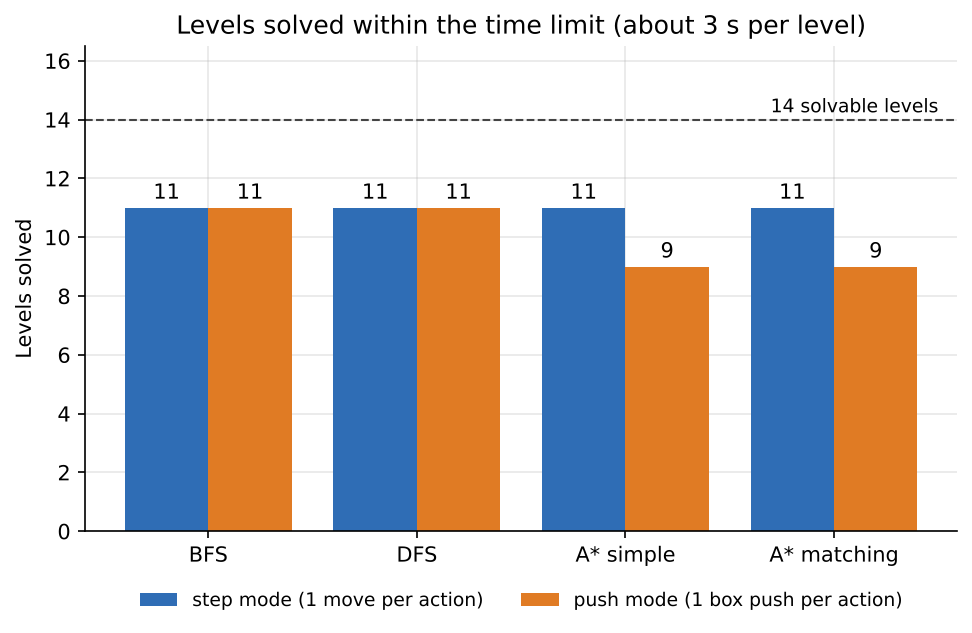
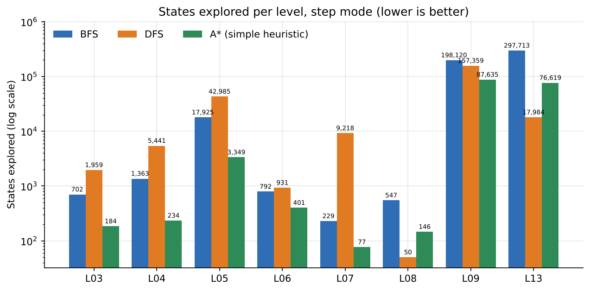
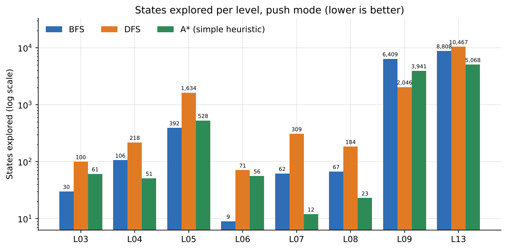
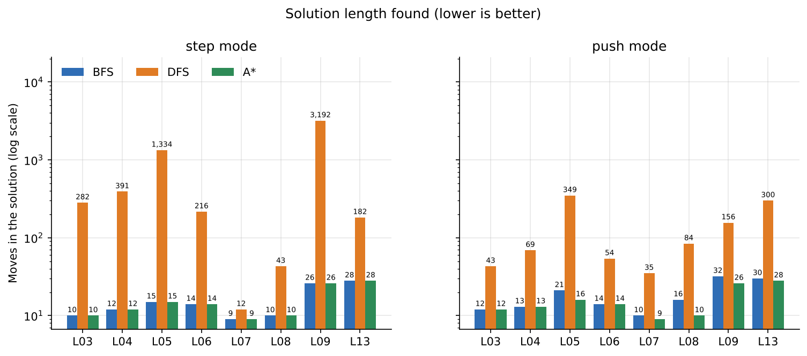
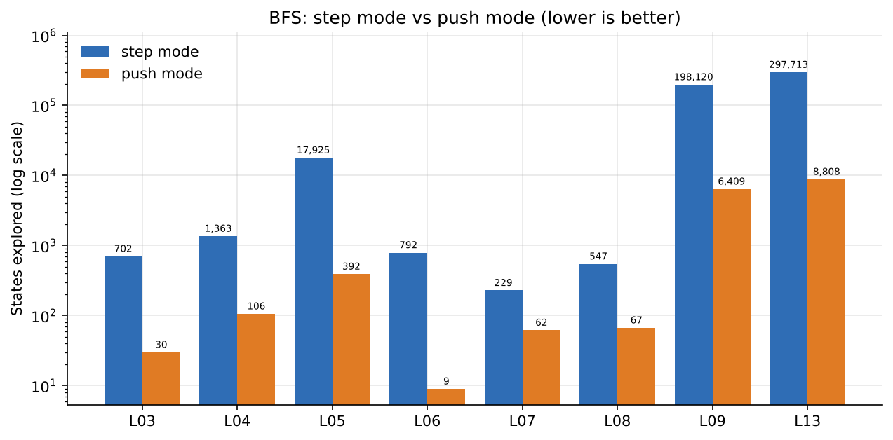
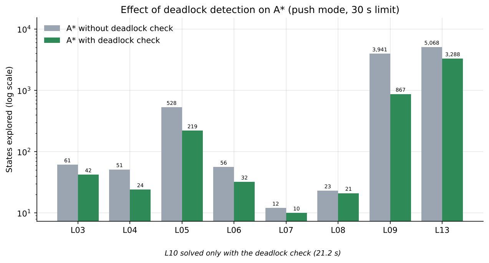
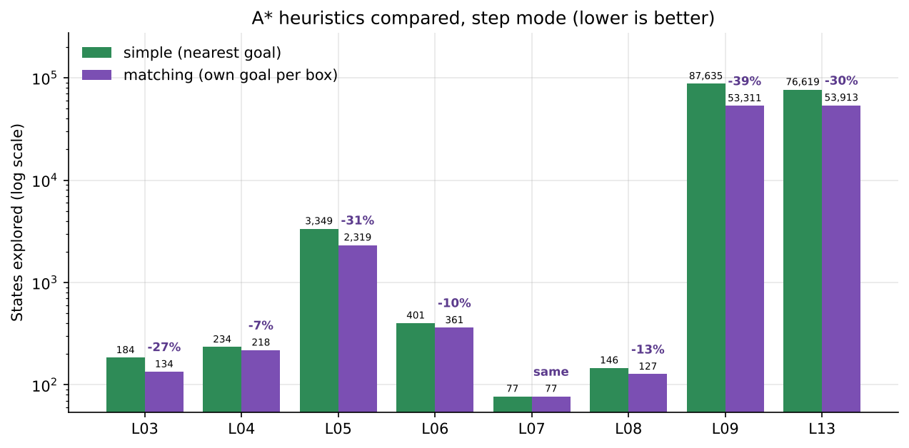

# Sokoban Solver: Comparing BFS, DFS and A*

## 1. Introduction

Sokoban is a puzzle in which a player pushes boxes onto goal squares. Boxes can only be pushed, never pulled, and a box cannot be pushed into a wall or into another box. A wrong push can make a level impossible to finish, which makes Sokoban a good test for search algorithms.

This project builds a Sokoban engine and three solvers (BFS, DFS and A*), adds two improvements to A* (a deadlock check and a stronger heuristic), and measures them on 16 levels. The questions we ask are:

1. How many levels can each algorithm solve in a fixed time?
2. How many states does each algorithm explore, and how long are its solutions?
3. How much do the deadlock check and the better heuristic help?

## 2. Team and contributions

| Member | Part of the project |
|---|---|
| Member 1 | Level loader, game engine (state, moves, rendering), `main.py`, engine tests, README start |
| Member 2 | BFS and DFS solvers, BFS/DFS experiment runner |
| Member 3 | A* solver and heuristics, A* experiment runner |
| Member 4 | Deadlock detection and its tests |
| Member 5 | Levels, results table, charts, report |

Each member should add or correct their own part of this report. Section 3 belongs to Member 1, Section 4.1 to Member 2, Sections 4.2 and 4.3 to Member 3, Section 4.4 to Member 4, and Sections 5 to 9 to Member 5.

## 3. Problem representation (engine)

* **State.** A `State` is an immutable pair: the player position and the set of box positions. Because it is hashable, solvers can store it directly in visited sets and dictionaries.
* **Level.** Walls and goals never change, so they are stored once in the `Level` object, together with the start state and the map size. A cell outside the map counts as a wall.
* **Level files.** Plain text: `#` wall, `@` player, `+` player on goal, `$` box, `*` box on goal, `.` goal, space for floor. The loader rejects files with no player, more than one player, or a different number of boxes and goals.
* **Actions.** `U D L R`. A lowercase letter is a plain step and an uppercase letter is a step that pushed a box. A solution is one string such as `dDD`, which can be replayed with `python -m src.main --level <file> --replay <solution>`.
* **Two search modes.**
  * *Step mode*: every action is one player step with cost 1.
  * *Push mode*: every action is one box push, with the walk to the pushing position included. The cost is the number of steps (walk plus push). Push mode has far fewer states. It uses `canonical()` as the visited key: two states with the same boxes and the same region the player can walk in count as the same position.

## 4. Algorithms

### 4.1 BFS and DFS

Both solvers keep a visited set, so no state is expanded twice.

* **BFS** uses a FIFO queue and stops when a goal state is generated. Every action costs 1, so in step mode it returns the solution with the fewest moves, and in push mode the solution with the fewest pushes.
* **DFS** uses a LIFO stack and marks a state as visited when it is taken from the stack. It uses little memory but gives no guarantee about solution length.

Both stop with a reason: `solved`, `no solution` (the whole reachable space was searched), `timeout` or `state limit`.

### 4.2 A*

A* keeps a priority queue ordered by f = g + h, where g is the cost so far and h is a heuristic estimate of the remaining cost. Ties are broken by smaller h, then by insertion order. A dictionary stores the cheapest g found for each state, and a worse duplicate taken from the queue is skipped.

### 4.3 Heuristics

* **Simple.** The sum, over all boxes, of the Manhattan distance to the *nearest* goal. Its weakness is that two boxes may choose the same goal.
* **Matching.** Every box gets its *own* goal so that the total Manhattan distance is the smallest. It is computed with a small dynamic programme over sets of goals. It is never smaller than the simple heuristic.

Both are lower bounds on the number of pushes still needed, and every push costs at least one step, so both are admissible.

### 4.4 Deadlock detection

A state is rejected as soon as it is certain to be unsolvable:

* **Dead squares.** A reverse search from every goal finds all squares from which a box can still reach some goal (ignoring other boxes). A box on any other square is stuck for ever. This also covers boxes in corners.
* **2x2 blocks.** If four neighbouring cells in a square are all walls or boxes, and at least one box is not on a goal, the state is dead.

Rejecting such states early shrinks the search.

## 5. Levels

The project has 16 level files, `Level-01.txt` to `Level-16.txt`. Difficulty rises with the number of boxes: 1 box is *tiny*, 2 or 3 boxes *medium*, and 4 or more boxes *hard*. Levels 15 and 16 have no solution on purpose, so that every solver is tested on the answer "no solution". In Level-15 the box lies in the top row and the player can never stand left of it to push it right. In Level-16 the box lies in the top row and the goal is in a lower row, so the box can never leave the top row.

| Level | Size | Boxes | Floor cells | Tier | Fewest pushes | Optimal moves* |
|---|---|---|---|---|---|---|
| Level-01 | 5x5 | 1 | 9 | Tiny | 1 | 1 |
| Level-02 | 5x7 | 1 | 15 | Tiny | 2 | 2 |
| Level-03 | 6x7 | 2 | 20 | Medium | 4 | 10 |
| Level-04 | 7x7 | 2 | 25 | Medium | 5 | 12 |
| Level-05 | 7x7 | 3 | 25 | Medium | 5 | 15 |
| Level-06 | 5x8 | 2 | 18 | Medium | 3 | 14 |
| Level-07 | 7x9 | 2 | 33 | Medium | 4 | 9 |
| Level-08 | 7x7 | 2 | 23 | Medium | 5 | 10 |
| Level-09 | 8x8 | 3 | 36 | Medium | 12 | 26 |
| Level-10 | 9x9 | 4 | 49 | Hard | 13 | - |
| Level-11 | 9x10 | 4 | 51 | Hard | 17 | - |
| Level-12 | 8x8 | 5 | 36 | Hard | 11 | - |
| Level-13 | 7x9 | 4 | 31 | Hard | 8 | 28 |
| Level-14 | 3x5 | 1 | 3 | Tiny | 1 | 1 |
| Level-15 | 4x5 | 1 | 6 | Unsolvable (test) | - | - |
| Level-16 | 5x7 | 1 | 15 | Unsolvable (test) | - | - |

\* Optimal moves are from BFS in step mode and are empty where BFS did not finish in time.

**Level checking.** When a solver times out we cannot tell "the level is impossible" from "the solver is too slow". We therefore checked every level with an independent exhaustive search over box pushes that shares no code with the solvers, and replayed one solution per level with the project engine. Result: all 14 non-test levels are solvable, and Levels 15 and 16 are not. Levels 11 and 12 are solvable (17 and 11 pushes) even though no solver finished them in the time limit.

## 6. Experimental setup

Raw results are in `experiments/results/`:

| File | Content | Time limit (read from the data) |
|---|---|---|
| `results_bfs_dfs.csv` | BFS and DFS, step and push mode | about 3 s |
| `my_astar_test.csv` | A* with simple and matching heuristic, step and push mode | about 3 s |
| `astar_without_deadlock.csv` | A*, push mode | 30 s |
| `astar_with_deadlock.csv` | A* with deadlock check, push mode | 30 s |

The limits are read from the data: every timed-out run in the first two files stopped at 3.0 to 3.7 s, and in the last two at about 30 s.

How we compare fairly:

* "Solved or not" is only compared **inside one experiment**, because the time limits differ.
* "States explored" of a **solved** level does not depend on the time limit, so it can be compared across files.
* Step mode and push mode count different things as a "state", so states are compared inside a mode.
* Moves and pushes of an unsolved level are left empty (the raw files store 0, which would pull averages down).
* Times were measured on one machine and change from run to run. State counts are exact. We re-ran all quick levels and got identical state counts to the CSV files (110 of 110 rows).

The cleaned tables are in `experiments/results/results_table.xlsx` and the charts in `experiments/results/charts/`.

## 7. Results

### 7.1 Levels solved



Of the 14 solvable levels, BFS and DFS solve 11 in both modes in about 3 s, and A* solves 11 in step mode but only 9 in push mode. The unsolved ones are Levels 10, 11 and 12 for every method, plus Levels 09 and 13 for A* in push mode (they need about 5 s). With 30 s, A* in push mode solves 11 levels without the deadlock check and **12 with it**. Level 10 (21.2 s) is solved only with the deadlock check. Levels 11 and 12 stay unsolved by all methods.

### 7.2 States explored and solution length

Step mode (levels solved by all three methods, Levels 01, 02 and 14 left out because they are trivial):

| Level | BFS states | BFS moves | DFS states | DFS moves | A* states | A* moves |
|---|---|---|---|---|---|---|
| Level-03 | 702 | 10 | 1,959 | 282 | 184 | 10 |
| Level-04 | 1,363 | 12 | 5,441 | 391 | 234 | 12 |
| Level-05 | 17,925 | 15 | 42,985 | 1,334 | 3,349 | 15 |
| Level-06 | 792 | 14 | 931 | 216 | 401 | 14 |
| Level-07 | 229 | 9 | 9,218 | 12 | 77 | 9 |
| Level-08 | 547 | 10 | 50 | 43 | 146 | 10 |
| Level-09 | 198,120 | 26 | 157,359 | 3,192 | 87,635 | 26 |
| Level-13 | 297,713 | 28 | 17,984 | 182 | 76,619 | 28 |

Push mode (A* from the 30 s run):

| Level | BFS states | BFS moves | DFS states | DFS moves | A* states | A* moves |
|---|---|---|---|---|---|---|
| Level-03 | 30 | 12 | 100 | 43 | 61 | 12 |
| Level-04 | 106 | 13 | 218 | 69 | 51 | 13 |
| Level-05 | 392 | 21 | 1,634 | 349 | 528 | 16 |
| Level-06 | 9 | 14 | 71 | 54 | 56 | 14 |
| Level-07 | 62 | 10 | 309 | 35 | 12 | 9 |
| Level-08 | 67 | 16 | 184 | 84 | 23 | 10 |
| Level-09 | 6,409 | 32 | 2,046 | 156 | 3,941 | 26 |
| Level-13 | 8,808 | 30 | 10,467 | 300 | 5,068 | 28 |




* In step mode A* explores fewer states than BFS on every level in the table, and its solutions are as short as BFS (which is optimal in step mode).
* In push mode A* explores fewer states than BFS on 5 of the 8 levels, but not on Levels 03, 05 and 06.
* DFS is unpredictable. It is the best on Level 08 (50 states in step mode) but needs 3,192 moves on Level 09, against 26 for BFS and A*.



BFS in push mode returns the fewest *pushes*, but not the fewest *moves* (for example 21 moves on Level 05, where the optimum is 15), because it ignores the walking.

### 7.3 Step mode versus push mode



Push mode explores far fewer states. For BFS on Level 09 the number drops from 198,120 to 6,409 (31 times fewer), and on Level 13 from 297,713 to 8,808.

### 7.4 Effect of the deadlock check

A*, push mode, 30 s limit:

| Level | States (no check) | States (check) | Saved | Time s (no check) | Time s (check) | Moves |
|---|---|---|---|---|---|---|
| Level-03 | 61 | 42 | 31.1% | 0.03 | 0.03 | 12 |
| Level-04 | 51 | 24 | 52.9% | 0.04 | 0.02 | 13 |
| Level-05 | 528 | 219 | 58.5% | 0.46 | 0.24 | 16 |
| Level-06 | 56 | 32 | 42.9% | 0.02 | 0.02 | 14 |
| Level-07 | 12 | 10 | 16.7% | 0.01 | 0.01 | 9 |
| Level-08 | 23 | 21 | 8.7% | 0.01 | 0.01 | 10 |
| Level-09 | 3,941 | 867 | 78.0% | 5.45 | 1.39 | 26 |
| Level-10 | not solved in 30 s | 7,355 | - | >30 | 21.23 | 31 |
| Level-11 | not solved in 30 s | not solved in 30 s | - | >30 | >30 | - |
| Level-12 | not solved in 30 s | not solved in 30 s | - | >30 | >30 | - |
| Level-13 | 5,068 | 3,288 | 35.1% | 4.80 | 4.31 | 28 |



Over the 11 levels solved both ways, the deadlock check reduces the states explored from 9,747 to 4,510, a saving of **53.7%**, and up to 78% on Level 09. The solutions are the same length. The check also makes Level 10 solvable within 30 s. Each state costs more with the check (for example 2.9 ms per state on Level 10), so the saving in time is smaller than the saving in states on Level 13.

### 7.5 Effect of the matching heuristic

A*, step mode:

| Level | simple (states) | matching (states) | Saved |
|---|---|---|---|
| Level-03 | 184 | 134 | 27.2% |
| Level-04 | 234 | 218 | 6.8% |
| Level-05 | 3,349 | 2,319 | 30.8% |
| Level-06 | 401 | 361 | 10.0% |
| Level-07 | 77 | 77 | 0.0% |
| Level-08 | 146 | 127 | 13.0% |
| Level-09 | 87,635 | 53,311 | 39.2% |
| Level-13 | 76,619 | 53,913 | 29.6% |



Over the 11 levels solved by both heuristics (including the trivial levels, where there is no difference), matching explores **34.5%** fewer states in step mode, and up to 39% fewer on Level 09. In push mode the saving is 22.4% over the 9 levels solved by both. It never explores more states than the simple heuristic in our data, and the solutions have the same length.

### 7.6 Time

Push mode, seconds (from the 30 s runs for A*):

| Level | BFS | DFS | A* | A* + deadlock |
|---|---|---|---|---|
| Level-05 | 0.13 | 0.39 | 0.46 | 0.24 |
| Level-09 | 2.59 | 0.73 | 5.45 | 1.39 |
| Level-13 | 2.31 | 1.85 | 4.80 | 4.31 |

A* explores fewer states but each state costs about 2.5 to 3.6 times more time than a BFS state (heuristic and priority queue). Because of this BFS was faster than plain A* on Levels 09 and 13 in push mode. The deadlock check brings A* on Level 09 from 5.45 s to 1.39 s.

## 8. Discussion

* **State model matters most.** Push mode gave the largest saving (about 30 times fewer states for BFS on Levels 09 and 13).
* **Pruning is the next biggest gain.** The deadlock check cut more than half of the states and solved one more level.
* **A better heuristic helps, but less.** The matching heuristic saved about a third of the states in step mode.
* **Fewer states is not always less time.** A* spends more time on each state. Cheap pruning pays off; an expensive heuristic needs to save a lot of states.
* **Push-mode A* is not strictly optimal.** It was 1 to 2 moves longer than the step-mode optimum on Levels 03, 04 and 05 (12 against 10, 13 against 12, 16 against 15). We tested the reason: when the visited key is the exact pair (player, boxes) instead of the player *region*, push-mode A* matches the step-mode optimum on Levels 03 to 08. Merging states by region keeps only the first, cheapest arrival, but a different player position inside the region could have made the following walks shorter.
* **Hard levels need more.** Levels 11 and 12 are solvable but no solver finished them in 30 s.

## 9. Limitations and future work

* Time limits differ between the experiments (about 3 s and 30 s), so some comparisons are only possible on solved levels.
* The deadlock check and the matching heuristic were not run together, so their combined effect is unknown.
* Only one run per setting was recorded, so times have no averages or error bars.
* The planned graphical replay window (Pygame) is not part of this version. Solutions are replayed in text with `python -m src.main --replay`.
* Next steps: combine the deadlock check with the matching heuristic, add stronger deadlock rules (for example frozen boxes along walls), use an exact (player, boxes) key or a better cost model in push mode, and aim at Levels 11 and 12.

## 10. Conclusion

All three algorithms solve the small and medium levels. Push mode, deadlock detection and a stronger heuristic each reduce the work of the search without changing the quality of the solution. The best result was A* with the deadlock check, which solved 12 of the 14 solvable levels in 30 s. The remaining two (Levels 11 and 12) are solvable, as an independent search proved, so they are a clear target for future work.

## Appendix: how to reproduce

```bash
python -m pytest -q
python -m experiments.codes.run_bfs_dfs --time-limit 3 --out experiments/results/results_bfs_dfs.csv
python -m experiments.codes.run_astar --time-limit 3 --out experiments/results/my_astar_test.csv
```
